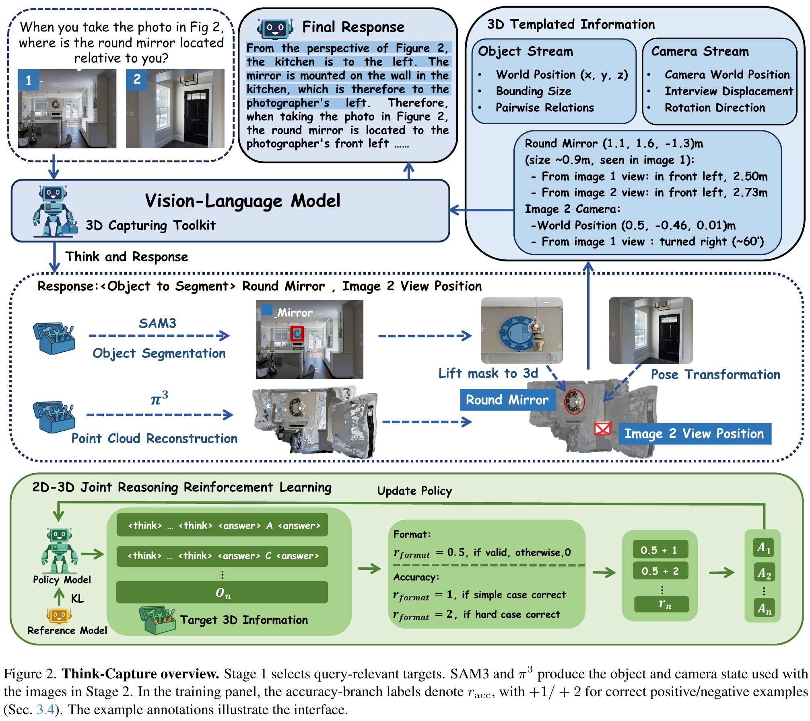

<div align="center">

# Think-Capture

### Active 3D Geometry Acquisition for Spatial Reasoning in Vision-Language Models

**WACV 2027**

Junjie Wang · Zhihao Yuan · Yunhan Tang · Sheng Xu · Jiaqi Mao<br>
Xiaoyu Ye · Yueru Luo · Xu Yan · Chun-Mei Feng · Zhen Li

[Overview](#overview) · [Results](#results) · [Setup](#setup) · [Evaluation](#evaluation) · [Training](#stage-2-training) · [Citation](#citation)

</div>

## Overview

Think-Capture lets a vision-language model select the objects it needs to inspect, obtains their geometry with SAM3 and Pi3X, and uses the resulting spatial descriptions to answer the question.



**Select targets, capture geometry, reason with evidence.** The model first identifies task-relevant objects. SAM3 masks are lifted into a shared 3D frame using Pi3X, then object and camera geometry is expressed as compact text for the second reasoning stage. GRPO training uses examples where geometry helps and examples where it misleads, so the model learns to combine spatial evidence with the original images.

## Results

Accuracy (%) reported in the paper, using Qwen3-VL-4B as the backbone:

| Benchmark | Backbone | Think-Capture | Gain |
| :--- | ---: | ---: | ---: |
| MindCube-Tiny | 32.9 | **54.4** | +21.5 |
| MMSI-Bench, positional subset | 31.2 | **39.1** | +7.9 |
| MMSI-Bench, full | 28.9 | **38.9** | +10.0 |
| ViewSpatial | 37.6 | **42.8** | +5.2 |

## Code

- `infer.py`: two-stage inference on your own images and question.
- `agent_tool_wrapper.py`: target-conditioned perception and spatial descriptions.
- `core.py`: mask-to-3D projection and object memory.
- `perception/` and `geometry/`: SAM3 and Pi3X interfaces.
- `eval_mindcube.py`, `eval_mmsi_bench.py`, and `ours/evaluation/eval_viewspatial.py`: benchmark evaluation.
- `ours/training/grpo_stage2/`: geometry caching, positive/negative data preparation, GRPO training, and a launch script.

## Setup

Use Linux with a CUDA GPU and Python 3.12. Install the PyTorch build appropriate for your CUDA environment, then install the Python dependencies:

```bash
git clone https://github.com/819346675/Think-Capture.git
cd Think-Capture
pip install -r requirements.txt
git clone https://github.com/yyfz/Pi3.git third_party/Pi3
git clone https://github.com/facebookresearch/sam3.git third_party/sam3
pip install -e third_party/sam3
```

Follow the upstream [Pi3X](https://github.com/yyfz/Pi3) and [SAM3](https://github.com/facebookresearch/sam3) instructions for their CUDA dependencies. Keep the newer PyTorch version required by SAM3 rather than installing Pi3's older pinned PyTorch requirements. Obtain access to the SAM3 checkpoint through its model page and authenticate with Hugging Face before using automatic downloads.

Run commands from the repository root. By default, the wrappers use `yyfz233/Pi3X` and `facebook/sam3`. For local checkpoints, set:

```bash
export PI3_CHECKPOINT=/path/to/Pi3X
export SAM3_CHECKPOINT=/path/to/sam3.pt
export VLM_MODEL=Qwen/Qwen3-VL-4B-Instruct
```

`PI3_PATH` and `SAM3_PATH` can point to source checkouts outside `third_party/`. `VLM_MODEL` also accepts a local Hugging Face model directory, including a trained Stage 2 model.

## Run the perception tool

For an end-to-end answer:

```bash
python infer.py --images scene/view1.jpg scene/view2.jpg \
  --question "Where is the chair relative to the table?" \
  --output outputs/example.json
```

To call the geometry tool directly:

```python
from agent_tool_wrapper import AgentToolWrapper, format_tool_result_for_model

tool = AgentToolWrapper(device="cuda")
result = tool.process_images(
    ["scene/view1.jpg", "scene/view2.jpg"],
    semantic_targets=["chair", "table"],
)
print(format_tool_result_for_model(result, question="Where is the chair relative to the table?"))
```

Input frames must share a resolution. At most four frames are sampled uniformly for geometry extraction. Geometry is anchored to the first selected camera, with OpenCV axes (+X right, +Y down, +Z forward). Same-label observations are fused across views by nearest-centroid matching within 0.5 m. Distances use Pi3X's estimated metric scale.

## Evaluation

Download each benchmark from its official release and set the relevant paths:

```bash
export MINDCUBE_JSONL=/path/to/MindCube/data/raw/MindCube_tinybench.jsonl
export MINDCUBE_IMAGE_ROOT=/path/to/MindCube/data
python eval_mindcube.py --num_samples 0

export MMSI_TSV=/path/to/MMSI_bench.tsv
python eval_mmsi_bench.py --num_samples 0

export VIEWSPATIAL_JSON=/path/to/ViewSpatial-Bench/eval/ViewSpatial-Bench.json
export VIEWSPATIAL_IMAGE_ROOT=/path/to/ViewSpatial-Bench
python ours/evaluation/eval_viewspatial.py --num_samples 0
```

Use `--baseline_only` for direct VLM inference, `--agent_only` for the tool-assisted pipeline, and `--prompt_style training` for the Stage 2 training prompt. A DeepSpeed checkpoint directory containing `mp_rank_00_model_states.pt` can be supplied through `--checkpoint_path`; load only checkpoints from a trusted source. For a Hugging Face checkpoint, use `VLM_MODEL` instead.

Results are written under `outputs/`, including responses and per-sample errors. Accuracy uses all selected samples as the denominator. Use `--num_samples 0` to evaluate the full input split.

## Stage 2 training

Install DeepSpeed and FlashAttention in the CUDA environment:

```bash
pip install deepspeed
pip install flash-attn --no-build-isolation
```

The trainer reads JSONL records with `question`, `images`, `formatted_3d`, `gt_answer`, and `sample_type`. Image entries are local paths; `formatted_3d` is the tool's text output. `sample_type` is `positive` (baseline incorrect, tool-assisted answer correct) or `negative` (baseline correct, tool-assisted answer incorrect). Optional `stage2_system` and `stage2_prompt` fields override the prompt template. Construct these records from the training split.

Cache geometry and collect disagreement examples from a MindCube-format training split, then combine the two groups:

```bash
python ours/training/grpo_stage2/cache_geometry.py \
  --data_path data/mindcube_train.jsonl --image_root data \
  --output_dir data/grpo_aligned
python ours/training/grpo_stage2/prepare_data.py \
  --positive data/grpo_aligned/grpo_stage2_positive_quality.jsonl \
  --negative data/grpo_aligned/grpo_stage2_negative_quality.jsonl \
  --output data/stage2_train.jsonl
```

An example four-GPU launch:

```bash
torchrun --standalone --nproc_per_node=4 ours/training/grpo_stage2/train.py \
  --model_path Qwen/Qwen3-VL-4B-Instruct \
  --data_path data/stage2_train.jsonl \
  --output_dir outputs/grpo_stage2 \
  --num_generations 8 --prompts_per_step 2 --max_steps 1600
```

The trainer uses ZeRO-2, a frozen vision encoder, within-prompt reward normalization, and a reference-policy KL penalty. It accumulates two prompts with eight completions each per optimizer update (16 completions), with a default limit of 1,600 updates. Correct answers receive +1 for positive samples or +2 for negative samples; complete `<think>...</think><answer>...</answer>` formatting receives +0.5. The generation group size must be divisible by the GPU count. Training writes DeepSpeed checkpoints and Hugging Face models under the output directory and resumes from its latest step checkpoint.

Alternatively, set `DATA_PATH`, `OUTPUT_DIR`, and optionally `NUM_GPUS`, then run `bash ours/training/grpo_stage2/run_train.sh`. For full-split evaluation, use `bash ours/evaluation/run_eval.sh mindcube` (or `mmsi` / `viewspatial`) with the data paths above.

## Tests

CPU unit tests for geometry, formatting, reward calculation, and error handling:

```bash
python -m unittest discover -s tests -v
```

## Citation

```bibtex
@inproceedings{wang2027thinkcapture,
  title={Think-Capture: Active 3D Geometry Acquisition for Spatial Reasoning in Vision-Language Models},
  author={Wang, Junjie and Yuan, Zhihao and Tang, Yunhan and Xu, Sheng and Mao, Jiaqi and Ye, Xiaoyu and Luo, Yueru and Yan, Xu and Feng, Chun-Mei and Li, Zhen},
  booktitle={IEEE/CVF Winter Conference on Applications of Computer Vision (WACV)},
  year={2027}
}
```

## License and acknowledgments

Project code is released under the MIT License. We thank the developers of [Qwen3-VL](https://github.com/QwenLM/Qwen3-VL), [SAM3](https://github.com/facebookresearch/sam3), and [Pi3X](https://github.com/yyfz/Pi3). Third-party code, checkpoints, and datasets remain subject to their respective licenses and access terms.

The method illustration is Figure 2 of the Think-Capture paper.
